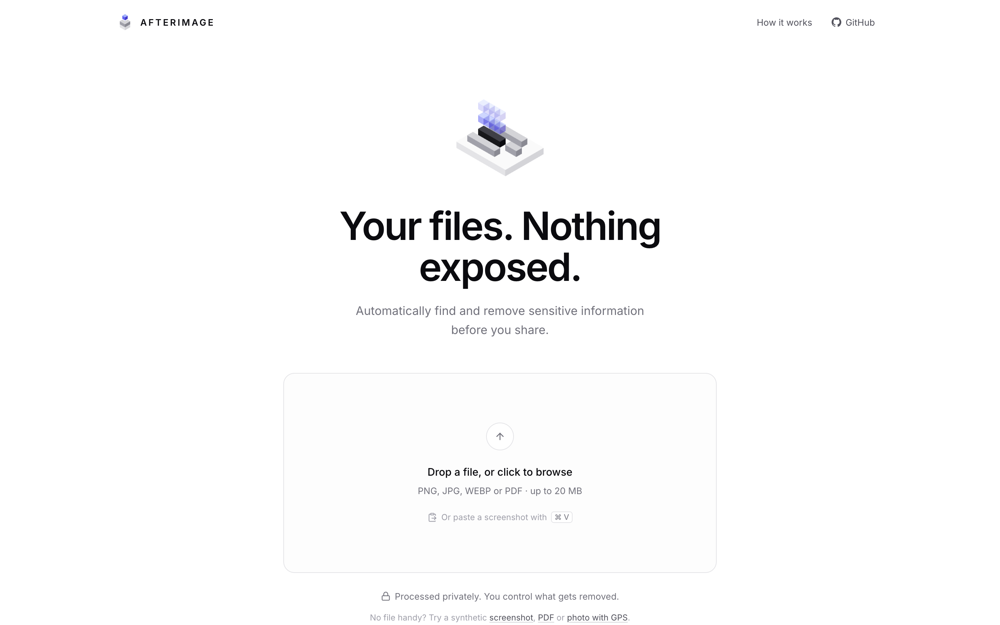
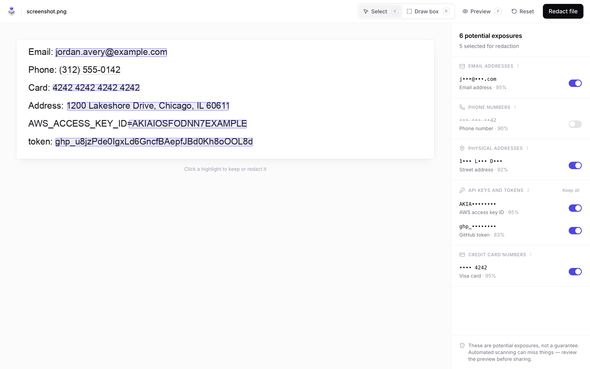
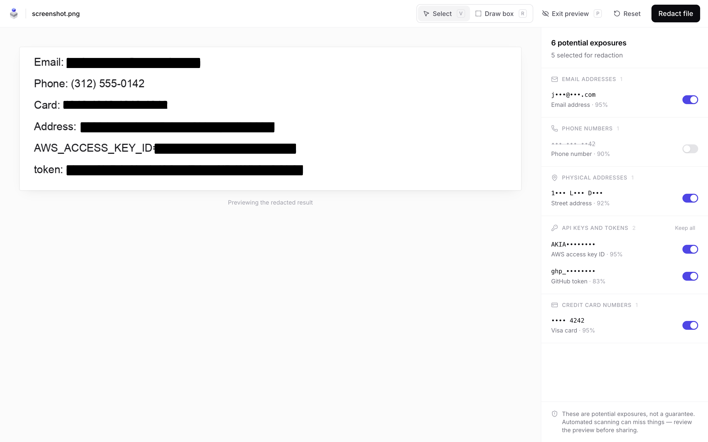
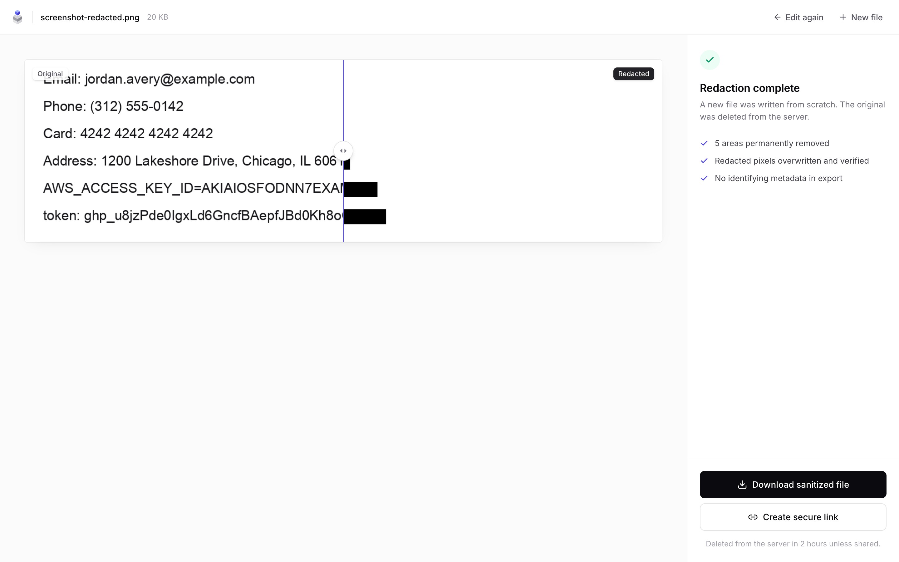
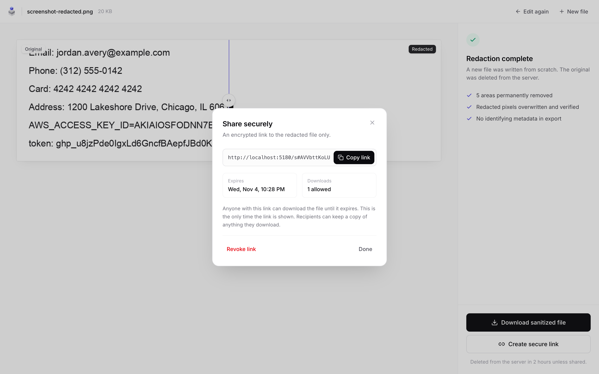
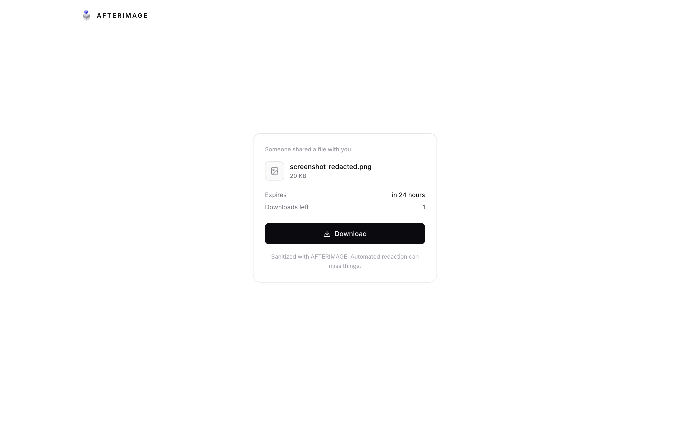
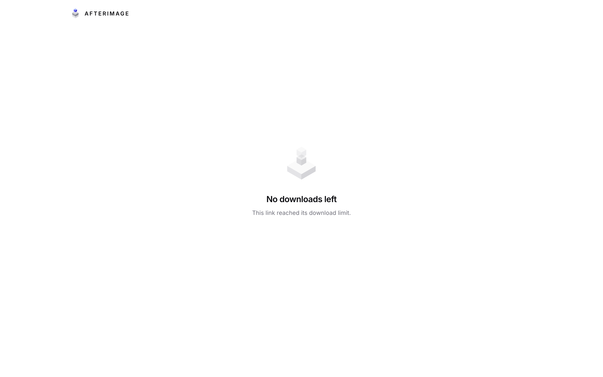

# AFTERIMAGE

Redact screenshots, photos and PDFs before you share them.

**Live demo: [afterimage-six.vercel.app](https://afterimage-six.vercel.app)** (the free-tier API sleeps when idle, so the first upload can take up to a minute)

AFTERIMAGE finds sensitive information in screenshots, photos and PDFs, lets you decide what to remove, **permanently** redacts it, and shares the clean file through encrypted, expiring, revocable links.

`UPLOAD → DETECT → REVIEW → REDACT → SHARE`



---

## Why this matters

People share screenshots of terminals, dashboards, bank statements and chat threads every day. Those images routinely contain API keys, email addresses, card numbers, home addresses, faces and GPS-tagged EXIF data. The usual fix (draw a black box in a markup tool, or place a rectangle over PDF text) often leaves the data recoverable. AFTERIMAGE is built around one idea: **removal has to be real, and the user stays in control.**

| Review | Preview |
| --- | --- |
|  |  |
| **Before / after** | **Share** |
|  |  |
| **Recipient** | **Link used up** |
|  |  |

The UI uses small isometric **voxel illustrations** rendered procedurally in SVG (`frontend/src/components/Voxels.tsx`): a document whose sensitive line lifts away and fades, an afterimage.

---

## Architecture

```
 Browser (React + Vite + Tailwind)
   │   file never leaves your machine except to the AFTERIMAGE API
   ▼
 FastAPI ── validation ── rate limits ── audit log ── scrubbed access log
   │
   ├─ detection/      Tesseract OCR · regex + validators · Presidio (names) · YuNet faces · EXIF/PDF metadata
   ├─ redaction/      Pillow pixel overwrite + re-encode · PyMuPDF true redaction + scrub (+ optional flatten)
   ├─ crypto/         AES-256-GCM envelope encryption · capability tokens · SHA-256 hashing
   ├─ sharing/        expiring, revocable, download-limited links (atomic SQL counter)
   ├─ services/       sessions · storage · cleanup · audit · rate limiting · upload validation
   │
   ├─ PostgreSQL      sessions, masked detections, artifacts (wrapped keys), shares (token hashes), audit events
   └─ Disk            encrypted blobs only (random names, 0600, inside a fixed root)
```

```
afterimage/
├── backend/
│   ├── app/{api,detection,redaction,crypto,sharing,models,schemas,services}
│   └── tests/            126 pytest tests + synthetic fixture generator
├── frontend/             React app (landing, workspace, result, share dialog, recipient page)
├── docker-compose.yml    postgres + api + nginx-served web
└── .github/workflows/ci.yml
```

### API

| Method | Path | Auth | Purpose |
| --- | --- | --- | --- |
| `POST` | `/api/files/analyze` | — | Upload + detect. Returns a session id and a one-time **session token** |
| `GET` | `/api/files/{session}/pages/{n}/preview` | `X-Session-Token` | Render the (encrypted-at-rest) original for review |
| `POST` | `/api/files/redact` | `X-Session-Token` | Apply selected detections + manual boxes; destroys the original |
| `GET` | `/api/artifacts/{id}/download` · `/pages/{n}/preview` | `X-Session-Token` | Owner download / after-preview |
| `POST` | `/api/shares` | `X-Session-Token` | Create a link. Returns the share token and a separate **manage token** once |
| `GET` | `/api/shares/{token}` | capability | Recipient metadata (does **not** consume a download) |
| `POST` | `/api/shares/{token}/download` | capability | Atomically consume one download |
| `GET` | `/api/shares/{id}/status` | `Bearer <manage token>` | Download count / revoked state |
| `DELETE` | `/api/shares/{id}` | `Bearer <manage token>` | Revoke |
| `GET` | `/api/admin/audit` | `Bearer <admin token>` | Read the security audit log |
| `GET` | `/api/health` | — | Capabilities (OCR, face backend, name detection) |

Downloads are `POST`, not `GET`, so chat-app link unfurlers and crawlers cannot burn a single-use link. Revocation needs a manage token that is distinct from the download token, so having a link does not let you kill it and guessing share IDs gets you nothing.

Errors are always structured: `{"error": {"code": "share_expired", "message": "This link has expired."}}`.

---

## Detection pipeline

1. **Decode safely.** Pillow with a pixel ceiling (decompression-bomb guard), EXIF orientation applied. PDFs are opened with PyMuPDF, with limits on page count and size.
2. **Text with coordinates.**
   - Images: Tesseract (`--oem 1 --psm 3`), with automatic inversion for dark-mode screenshots and 2× upsampling for small UI text.
   - PDFs: the native text layer (`page.get_text("words")`), plus OCR for scanned pages and pages with significant imagery. OCR words that overlap native text are dropped.
   - Words are joined into a `TextLayer` that maps every character offset back to a box. A match is converted to **one box per visual line**, and partially matched tokens are sliced proportionally (so `email:jordan@…` keeps `email:` visible).
3. **Detectors** (`detection/pii.py`, `detection/secrets.py`). Precision comes first.
   - **Email**: RFC-ish pattern that rejects `icon@2x.png`-style file names.
   - **Credit cards**: 13–19 digits with consistent separators, then **Luhn**, then a known network IIN range.
   - **Phone**: `phonenumbers` validity check. Context words (`phone`, `tel`, `call` …) raise confidence; bare digit runs are flagged *uncertain*.
   - **IP addresses**: `ipaddress` validation; `version 1.2.3.4` is skipped.
   - **GPS**: decimal pairs within lat/lon ranges, and DMS notation.
   - **Physical addresses**: US street + suffix, joined with a following `City, ST 12345`; PO boxes.
   - **SSN** (area/group/serial rules), **IBAN** (mod-97).
   - **Secrets**:
     - Provider formats: AWS, GitHub, GitLab, Slack, Stripe, OpenAI, Anthropic, Google, SendGrid, Twilio, npm, PyPI, webhooks.
     - Structural formats: JWT (header decoded and checked), PEM private-key blocks spanning lines, Bearer/Basic auth, credentials in URLs.
     - High-entropy values, but **only next to a contextual keyword** (`api_key=`, a "Secret key" label on the previous line). Placeholders (`****`, `${VAR}`, `os.environ…`) are ignored. Random hashes and UUIDs with no context are deliberately *not* flagged.
   - **Person names**: Microsoft Presidio with spaCy `en_core_web_sm`, run locally. Names are capped below the auto-select threshold, so the user must opt in.
4. **Overlap resolution.** Secret > card > email > ID > phone > address. A weaker match that is mostly covered by a stronger one is dropped.
5. **Faces.** OpenCV **YuNet** CNN (bundled 230 KB ONNX). It falls back to Haar cascades if the model is missing. Boxes are padded to cover hair and edges.
6. **Metadata.**
   - EXIF: GPS, device make/model, software, capture time, serial numbers, owner. Also XMP and PNG text chunks.
   - PDF: author, creator, producer, title, dates, XMP, annotations, form fields, links, attachments.

Each finding is presented as a *potential exposure* with a confidence score. Anything ≥ 0.6 is pre-selected; the rest is shown as **uncertain** and left off. The user approves every redaction and can add manual boxes (draw, move, resize, delete).

> No automated scan can promise it found everything. The UI says so on every review screen.

Only **masked previews** (`j•••@•••.com`, `•••• 4242`, `ghp_••••••••`) and box geometry are stored. Raw OCR text and matched values are never persisted.

---

## Why redaction is not the same as hiding content

| "Hiding" | What AFTERIMAGE does |
| --- | --- |
| A CSS overlay or annotation drawn on top of an image | Pixels are overwritten in a decoded bitmap. That bitmap is copied into a **new image object** and **re-encoded**; the original encoded bytes are never reused. |
| A black rectangle placed over PDF text | PyMuPDF **redaction annotations are applied**. Glyphs under the area are deleted from the content stream, overlapping image pixels are blanked, and vector art inside the area is removed. |
| Leaving EXIF, XMP, ICC device profiles, PNG text chunks | Rebuilt from raw pixels: no EXIF/XMP/text chunks. ICC is converted to sRGB, then dropped. |
| Leaving PDF comments, form values, attachments, JavaScript, prior revisions | All annotations and widgets deleted. `doc.scrub()` removes metadata, XMP, JS, embedded files, links, hidden text and thumbnails. The file is rewritten with `garbage=4` so **no earlier revision survives**. |

Every export is **verified before it is stored**:

- **Images**: re-opened. The format must match, there must be zero EXIF/XMP/ICC/text, and every redacted region's interior must be the fill colour (exact for PNG, with a tolerance for lossy codecs).
- **PDFs**: re-opened. `get_text()` inside every redacted rectangle must return nothing, no annotations or metadata may remain, and the text that was under each box (held in memory only) must no longer extract anywhere. If the same value also appears somewhere the user *didn't* select, the result screen warns about it.
- **Optional "Flatten pages"**: every page is rasterised (200 DPI) into a brand-new PDF. This is the strongest guarantee.

Tests prove known synthetic secrets cannot be recovered from exported PDFs, both through text extraction and by scanning every decompressed object stream.

---

## Encryption design

- **Envelope encryption with AES-256-GCM** (`cryptography`'s `AESGCM`; no custom primitives).
  - Every stored object (upload original or sanitized artifact) gets a fresh random 256-bit **data key**.
  - The data key is **wrapped** with the master key (also AES-256-GCM) and stored in PostgreSQL. Only ciphertext is written to disk.
  - Every encryption uses a fresh random 96-bit nonce.
  - The object's purpose and ID are bound as **associated data**, so a blob cannot be swapped onto another record, and an "original" cannot be served as an "artifact".
  - Filenames are encrypted too.
- **Master key** comes from `AFTERIMAGE_MASTER_KEY` (base64url, 32 bytes). The app refuses to start without it, and nothing is hard-coded. It never reaches the browser.
- **Crypto-shredding**: deleting the DB row destroys the wrapped key, so a lingering blob is unreadable. Files are also overwritten before unlink, which is best effort on SSDs.
- An integrity check (SHA-256 of the plaintext) runs on every decrypt.

## How expiring encrypted links work

1. The owner (holder of the session token) asks for a link with an expiry (1 h / 24 h / 7 d) and a download cap (1 / 5 / unlimited).
2. The server generates two independent 256-bit tokens with `secrets.token_urlsafe(32)`: a **share token** and a **manage token**. It stores **only their SHA-256 hashes** and returns both once.
3. The link is `https://host/s#<token>`. The token is in the **URL fragment**, which browsers never send in requests or `Referer` headers. So it never appears in web-server logs, proxies or analytics. The recipient page reads it client-side and calls the API.
4. A download runs one conditional statement:
   ```sql
   UPDATE shares SET download_count = download_count + 1
   WHERE token_hash = :h AND revoked_at IS NULL AND expires_at > now()
     AND (max_downloads IS NULL OR download_count < max_downloads)
   RETURNING id
   ```
   PostgreSQL row locking arbitrates races. With a cap of 1, exactly one of 24 simultaneous requests succeeds (tested). The count is committed only after the file has been decrypted.
5. Revoked, expired and exhausted links return `410` with a specific reason. Unknown tokens return `404` and count toward an auth-failure lockout.
6. A background task deletes expired sessions, originals, artifacts and their shares (and orphaned blobs). An artifact lives exactly as long as its longest-lived link; unshared artifacts are removed after 2 hours.

> **A recipient can keep anything they download.** Expiry and revocation control future access through the link, not copies already made.

---

## Threat model

**Protects against:**
- Accidentally sharing recoverable redactions (text under boxes, metadata, PDF history).
- Link leakage through logs or Referer.
- Link guessing or enumeration (256-bit tokens, hashed at rest, rate-limited failures).
- Replay beyond limits, including concurrent bursts.
- A third party revoking your link.
- Disk or backup theft without the master key.
- Path traversal.
- Malicious or malformed uploads (signature + full decode, decompression-bomb limits, page caps, encrypted PDFs rejected).
- Accidental exposure of the original (it is never shareable, and is destroyed after redaction).

**Does not protect against:**
- A compromised server or a stolen master key.
- A malicious recipient.
- Sensitive content the detectors miss and the user doesn't box.
- Information inferable from context around a redaction (box width, layout).
- Traffic analysis.

**Trust assumption:** the AFTERIMAGE server operator is trusted with plaintext *during processing*. Files are processed server-side by local models, and nothing is sent to third-party AI services.

## Security controls (implemented)

- AES-256-GCM envelope encryption at rest. Per-object keys, AAD binding, tamper detection.
- Capability tokens (256-bit) stored as SHA-256 hashes; constant-time comparisons.
- Separate session, share, manage and admin credentials.
- Server-side expiry, revocation and atomic download limits.
- Strict upload validation: magic bytes + full decode, a 20 MB streamed limit, `Content-Length` pre-check, pixel/side/page limits, rejection of animated and encrypted inputs.
- Bounded concurrency for CPU-heavy jobs and an OCR timeout.
- Random server-generated storage keys, regex-validated and root-confined (traversal tests).
- Rate limits per IP and route, plus an auth-failure lockout.
- Security headers on every response:
  - API: CSP `default-src 'none'`, `nosniff`, `X-Frame-Options: DENY`, `Referrer-Policy: no-referrer`, `Cache-Control: no-store`, HSTS in production.
  - Downloads: `Content-Disposition: attachment` with a sanitized RFC 5987 filename, plus a sandbox CSP.
  - nginx: a strict CSP.
- Uvicorn access log disabled and replaced with a scrubbed access log; a logging filter redacts anything token-shaped from every log record.
- **Security audit log** in PostgreSQL:
  - Events: analyzed, rejected, redaction completed/failed, share created/accessed/downloaded, denied (expired / revoked / limit / not found), revoked, auth failed, rate limited, invalid request, cleanup.
  - Details pass through an allow-list, and IPs are stored as HMAC pseudonyms.
  - Viewable via `GET /api/admin/audit` or `python -m app.cli audit`.
- Hardened container: non-root, read-only filesystem, `cap_drop: ALL`, `no-new-privileges`, memory and PID limits. API docs are disabled in production.

## Known limitations

- **Faces**: YuNet is tested only for "runs and returns valid boxes". The fixture library has no face photos (the project avoids real people's images), so face-detection accuracy is **not** covered by automated tests.
- **Detection coverage**: address and phone detection are US-centric; person-name detection uses the small spaCy model, which is noisy, so names are never auto-selected; OCR quality drops on tiny, stylised, rotated or low-contrast text.
- **PDF content without real text**: text drawn as vector paths or embedded as Type3 glyph images isn't detected as text. The workaround is to box it manually and turn on **Flatten pages**. Without flattening, vector graphics only partially covered by a box are covered rather than removed. Optional-content layers and XFA forms aren't analysed; scrubbing removes forms and hidden text, but flattening is the recommended path for complex PDFs.
- **Other unsupported inputs**: password-protected PDFs, animated images and HEIC/TIFF/SVG are rejected.
- **Original deleted after redaction**: the original is deleted once redaction finishes, so **Edit again** re-uploads the copy held in your browser tab and re-applies your choices.
- **Deployment gaps**:
  - Rate limiting is in-process (single instance).
  - Schema is created with `create_all` (no migration history).
  - The secure-overwrite step is best effort on SSDs and copy-on-write filesystems; crypto-shredding is the real guarantee.
  - Docker Compose and the GitHub Actions workflow were written but **not executed** in the development environment (no Docker daemon available). Locally, tests ran against PostgreSQL 16 with Tesseract 5.5.

## Future improvements

- Shared (Redis) rate limiting.
- Alembic migrations.
- KMS-managed master keys with rotation (the `key_id` column is already in place).
- Malware scanning of uploads.
- Client-side (in-browser WASM) detection, so the server never sees plaintext.
- Optional link passphrases.
- Owner dashboard for active links.
- Locale-aware PII (EU addresses, national IDs).
- Labelled face fixtures for accuracy tests.

---

## Local installation

Requirements: Python 3.12+, Node 20+, PostgreSQL 14+, Tesseract 5 (`brew install tesseract` / `apt install tesseract-ocr`).

```bash
make setup
```

```bash
createdb afterimage && createdb afterimage_test
```

```bash
cd backend && .venv/bin/python -m app.cli genkey > .env && echo "AFTERIMAGE_DATABASE_URL=postgresql+psycopg://localhost/afterimage" >> .env
```

Then run the API and the web app in two terminals:

```bash
make api
```

```bash
make web
```

Open http://localhost:5173. Vite proxies `/api` to `:8000`.

### Docker

```bash
cp .env.example .env
```

Fill in `POSTGRES_PASSWORD` and paste the output of `python -m app.cli genkey`, then:

```bash
docker compose up --build
```

The app is served at http://localhost:8080.

## Running tests

```bash
make test
```

Recorded result in development: **126 passed** (PostgreSQL 16, Tesseract 5.5.3, Python 3.12, macOS).

Coverage:

| Area | Tests |
| --- | --- |
| Email, phone, card (Luhn and network), SSN, IBAN, IP, GPS, address detection | positive and false-positive cases |
| Secret patterns | provider formats, JWT, PEM, Bearer, URL credentials, contextual entropy, placeholders and hashes not flagged |
| OCR pipeline | light and dark screenshots |
| Image redaction permanence | PNG/JPEG/WEBP: pixel checks, re-OCR, re-analysis; transparency; EXIF orientation |
| Metadata stripping | EXIF GPS/device/serial, PNG text chunks |
| PDF redaction permanence | text extraction and raw stream scan, flattened mode, rotated pages, scanned PDFs via OCR, residual-occurrence warning, metadata and annotations removed |
| Crypto | round trip, tampering (body/nonce/tag/wrapped key), AAD binding, wrong key, nonce uniqueness, token hashing |
| Sharing | expired, revoked, max downloads, **24-thread concurrent limit enforcement (limits 1 and 5)**, unauthorized revoke, owner-only creation, metadata view doesn't consume downloads |
| Uploads | empty, wrong type, executable, SVG, truncated, extension spoofing, oversized, decompression bomb, encrypted PDF, page limit |
| Access control | cross-session tokens, foreign detection IDs, path traversal (encoded and raw), storage-key validation, auth-failure lockout, security headers |
| Logging and audit | tokens never logged, audit trail contents, IP pseudonymisation, admin endpoint |
| Cleanup | expired sessions, originals, artifacts and shares deleted |

The synthetic fixture library (`backend/tests/fixtures/synthetic.py`) generates every document at test time. It uses fake data only: `example.com`, 555-01xx numbers, the public Stripe test card, AWS's documented example key, and runtime-generated token strings, so no credential-shaped literal is committed. Write samples to disk with `make samples`.

## Demo walkthrough

1. Open the app and click **Try a synthetic screenshot**, or paste a screenshot with ⌘V.
2. The workspace shows **"6 potential exposures"**: email, phone, address, AWS key, GitHub token, card. Hover a row to highlight its region; click a highlight to keep or redact it.
3. Press **R** and drag a box over anything else. Press **V** to move or resize it, and **Delete** to remove it.
4. Press **P** to preview the result, then **Redact file**.
5. Drag the before/after slider and read the verification checklist. Click **Download** or **Create secure link**.
6. Pick *24 hours · 1 download*, then **Generate** and **Copy**. Open the link in another browser: the recipient sees the file name, expiry and downloads left. After one download, the link shows **"No downloads left"**.
7. Try the **PDF** sample. The *Hidden metadata* section lists the author, creator and the reviewer comment, all of which are stripped. After redaction, select-all/copy in any PDF viewer finds nothing under the boxes.
